# Admonitor-server

 广告数据监控服务  

## 使用说明

* 如果账户有新增账号，则运行一次：位于test中
```golang
	config.Initialize()
	s := popin_spider.NewPopinSpider()
	s.InitAccounts()
```
```golang
	config.Initialize()
	s := line_spider.NewLineSpider()
	s.InitAccounts()
```

### 后端部分  

* 目前已经完成line数据的爬取【✅】  
* 准备开展popin数据的爬取 【✅】  

### 前端部分  

* AdmonitorUI开发：为方便使用手机实时查看数据，原生小程序开发 【✅】  

## 关于报警系统

* 当某一指标数据过低时，会发送警报信息

## 服务结构  



## .gitignore的编写  

忽略二进制文件  

```bash
# 忽略掉所有文件
*
# 取消忽略所有带有后缀名的文件
!*.*
# 取消忽略所有目录
!*/
```

## 强制重置仓库

 .gitignore文件目录下CMD输入

```bash
git rm -r --cached .
```

 重置  

```bash
git checkout --orphan latest_branch
git add -A
git commit -am newest
git branch -D main
git branch -m main
```

 提交

```bash
git push -f origin main
```

一键提交

```bash
git add .
git commit -m update --no-verify
git push origin main
git push origin-t main
```

注意：
1、 .gitignore只能忽略那些原来没有被track的文件，如果某些文件已经被纳入了版本管理中，则修改.gitignore是无效的。

2、 想要.gitignore起作用，必须要在这些文件不在暂存区中才可以，.gitignore文件只是忽略没有被staged(cached)文件， 对于已经被staged文件，加入ignore文件时一定要先从staged移除，才可以忽略。
